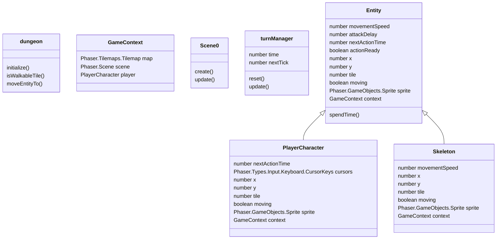

Implementation of the game from the book [Roguelike Development with JavaScript](https://link.springer.com/book/10.1007/978-1-4842-6059-3) 

Deployed [here](https://hidden-smoke-7075.fly.dev/games/rogue0/rogue0)

## Action-time scheduling

Heroes and monsters share a discrete-event timeline, inspired by Shattered Pixel
Dungeon. Each actor has a `nextActionTime`; the earliest actor acts next. Fractional
costs accumulate without rounding. Ties give the hero priority, then preserve
entity order. Waiting for player input or an animation does not advance game time.
Items are not actors. There are no movement/action-point pools.

Current Rogue0 action costs (normal action = 1 time unit):

| Action | Cost |
| --- | --- |
| Move, including pickup on the destination tile | `1 / movementSpeed` |
| Attack, hit or miss | Equipped weapon's `attackDelay` |
| Weapon-based skill | Weapon's attack delay |
| Use item, throw, equip/unequip, drop, non-weapon skill, wait | 1 |
| Search | 2 |
| Invalid action, inspection, open backpack | 0 |

Normal actors move at speed 1. Ghouls move at speed 2 but attack at normal speed.
Haste doubles movement speed only; cripple halves it. Rooting prevents movement
but permits attacks and other actions. Frozen actors lose one scheduled action;
terrified monsters flee on their own scheduled actions, not in buff tick callbacks.
Weapons default to attack delay 1; axes take 1.25 and war hammers 1.5. These are
Rogue0 balance values, not a claim to reproduce SPD's entire item/balance table.

Hunger and regeneration tick per elapsed world-time unit. Buffs keep their own
tick phase (a two-time-unit buff applied at 0.5 expires at 2.5), and skill cooldowns
use absolute ready timestamps. Faster movement does not accelerate hunger,
poison, or cooldowns. Floor changes preserve the clock and buff/cooldown timing.
Animation durations and frame rate never determine logical action costs.

Run the headless regression checks with `node scripts/test-rogue0-movement.mjs`.

