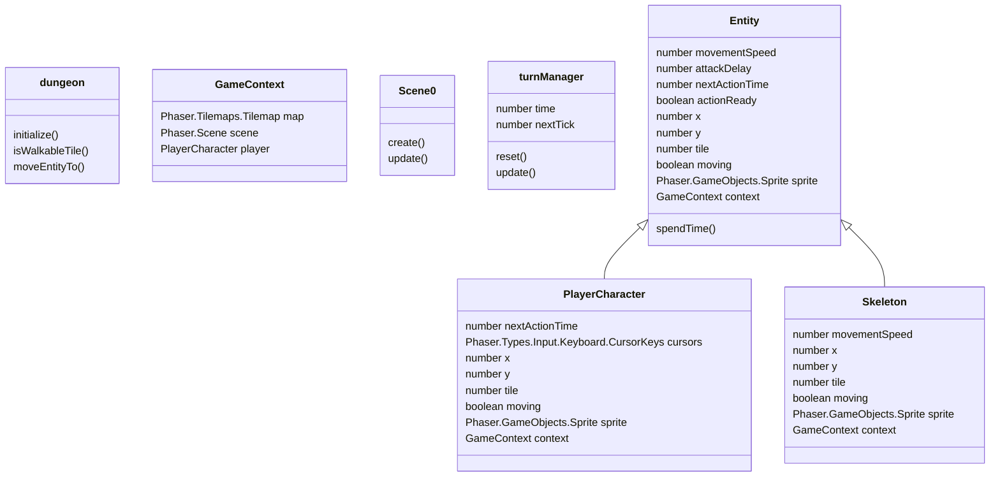

Implementation of the game from the book [Roguelike Development with JavaScript](https://link.springer.com/book/10.1007/978-1-4842-6059-3) 

Deployed [here](https://hidden-smoke-7075.fly.dev/games/rogue0/rogue0)

## Action-time scheduling

Heroes and monsters share a discrete-event timeline, inspired by Shattered Pixel
Dungeon. Each actor has a `nextActionTime`; the earliest actor acts next. Fractional
costs accumulate without rounding. Ties give the hero priority, then preserve
entity order. Waiting for player input or an animation does not advance game time.
Items are not actors. There are no movement/action-point pools.

Current Rogue0 action costs (normal action = 1 time unit):

| Action | Cost |
| --- | --- |
| Move, including pickup on the destination tile | `armorStrengthPenalty / movementSpeed` |
| Attack, hit or miss | Equipped weapon's `attackDelay × weaponStrengthPenalty` |
| Weapon-based skill | Weapon's penalized attack delay |
| Use item, throw, equip/unequip, drop, non-weapon skill, wait | 1 |
| Search | 2 |
| Invalid action, inspection, open backpack | 0 |

Search (`s`, the Search button, or a second press of the magnifying glass)
reveals nearby hidden traps and secret doors. It never disarms traps, including
on repeated searches. Inspecting a trap remains free. Item-based disarming is
only a possible future mechanic. Generated frost, teleport and alarm traps are
reusable; dart, fire, arrow, summon, geyser and confusion traps are single-use. Searching
never changes their activation policy.

**Chasms:** move into an adjacent chasm with a direction key or tap its tile.
An “Are you sure?” confirmation warns about the fall before committing.
Accepting drops you into the next floor, costs movement time, and deals
`ceil(max HP / 3)` damage on arrival, ignoring armor; final-floor falls are
fatal. Cancelling is free. Rooted heroes cannot step into chasms; levitating
heroes cross safely. Auto-walk routes still avoid chasms. There is no Jump
button or `v` shortcut.

There is **no player shove ability**. `dungeon.knockback(context, target, dx, dy)`
is an effect-level primitive for one cardinal tile of forced movement, with no
extra victim action cost. Grounded actors pushed into chasms fall; levitating
actors remain aloft. The existing floor-fall path handles player transitions
outside the scheduler; monster falls use normal death removal.

**Geyser traps** are the first push-producing effect. Grounded players and
monsters activate them on entry; items and levitating actors do not. The blast
pushes one tile in the direction of entry (horizontal for diagonal entry), can
chain into another geyser, and preserves landing-terrain contacts. Blocked or
rooted victims stay on the plate, but the trap is still spent. Geysers deal no
direct damage and cost no extra action time; chasm landings use normal fall
rules. Generated geysers are single-use and share the existing hidden-trap
budget. Search only reveals them, and floor snapshots preserve spent state.
**Confused** lasts four elapsed world-time units. Movement attempts choose a
random cardinal neighbor without rerolling unsafe choices. Walls, closed doors
and actors block a stumble but still cost movement time; roots prevent attempts.
Chasms can cause accidental falls unless the actor is levitating. Keyboard,
auto-walk and enemy movement/fleeing use the same rule. Deliberate attacks,
skills and aiming stay unchanged. Stumbles do not automatically pick up loot,
and player stumbles cancel auto-walk and buffered commands. Single-use confusion
traps affect grounded players and monsters and share the existing trap budget;
levitation bypasses them and search reveals without disarming.

Normal actors move at speed 1. Ghouls move at speed 2 but attack at normal speed.
Haste doubles movement speed only; cripple halves it. Rooting prevents movement
but permits attacks and other actions. Frozen actors lose one scheduled action;
terrified monsters flee on their own scheduled actions, not in buff tick callbacks.
Weapons default to attack delay 1; axes take 1.25 and war hammers 1.5. These are
Rogue0 balance values, not a claim to reproduce SPD's entire item/balance table.

Hunger and regeneration tick per elapsed world-time unit. Buffs keep their own
tick phase (a two-time-unit buff applied at 0.5 expires at 2.5), and skill cooldowns
use absolute ready timestamps. Faster movement does not accelerate hunger,
poison, or cooldowns. Floor changes preserve the clock and buff/cooldown timing.

Poison clouds add independent fractional terrain events to this same scheduler:
clouds last 4 time units and pulse once per unit from their creation phase.
Exposure sustains Poisoned for at least 2 units without postponing its damage
phase; expiry wins ties with a cloud pulse. Clouds are separate from ground
features, affect levitating actors too, and pause with inactive floors. Rendering
only displays visible clouds; it never advances their lifetime.
Animation durations and frame rate never determine logical action costs.

Food drops by 0.25 per world-time unit. Fed (30–100 Food) heroes naturally
recover 1 HP every 3 units, capped at maximum HP. Hungry (0 < Food < 30) heroes
neither naturally heal nor take hunger damage. Starving (0 Food) heroes lose
1 HP per unit. Eating stops starvation immediately; natural healing resumes
once Food is at least 30 (evaluated after that unit's food drain). Potions and
magical healing are unaffected. These are SPD-inspired states with Rogue0
balance values, not an exact reproduction of SPD. Entering a floor does not heal.

## Run length and equipment progression

A run has **25 floors**, with the unchanged Bone Lord on floor **25**. The old
five-floor limit was for testing. Themed regions and later-region enemy scaling
are still future work; ordinary enemy counts stop growing after floor 5.

Heroes start with **10 Strength**. Strength potions permanently add one Strength,
not attack. XP still grants +5 max HP / +1 attack; talents are not implemented.
Physical equipment requires `8 + 2 × tier` Strength. Upgrades reduce that
requirement at +1, +3, +6, +10, … (minimum 0). For each missing point, weapons
multiply attack time by 1.2 and divide accuracy by 1.2; armor multiplies movement
time by 1.2 and divides evasion by 1.2. Meeting the requirement removes penalties.
Wands and utility items are exempt. Status/hunger clocks remain world-time based.

Dungeon equipment spans tiers 1–5: Dagger through Greataxe and Cloth through
Plate Armor. Tier and upgrade level are independent. Weapon damage at tier `t`,
upgrade `u` ranges from `t + u` to `5t + (t + 1)u`; armor absorbs `2t + tu`.
Class starting gear retains its previous stats. Armor replaces a shield in the
same slot. Both gems and upgrade scrolls support the new gear. Artwork remains
a placeholder using the existing weapon/shield silhouettes.

Each five-floor band guarantees two Strength potions (floors 2/4 within the
band), three upgrade scrolls (1/3/4), a band-tier weapon (1), and armor (3).
That is **10 Strength potions and 15 upgrade scrolls** across the run; neither
appears as extra random floor loot. Gems from monsters still provide additional
upgrades. Random equipment normally matches its band but can be one tier earlier
or later. Floor snapshots preserve remaining loot, so revisits do not refill it.
These are initial progression curves, not a claim of full-run balance.

Run all headless regressions with `npm run test:rogue0`; run the focused
progression checks with `node scripts/test-rogue0-progression.mjs`.

