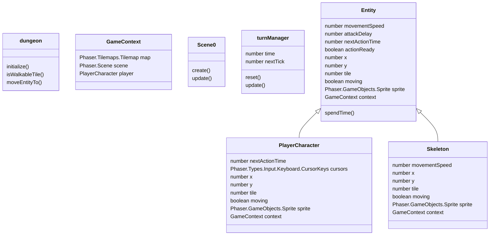

Implementation of the game from the book [Roguelike Development with JavaScript](https://link.springer.com/book/10.1007/978-1-4842-6059-3) 

Deployed [here](https://hidden-smoke-7075.fly.dev/games/rogue0/rogue0)

## Development boundaries

- `combat.ts` resolves attack attempts and rolls damage. `combatApplication.ts`
  owns successful-hit application: damage, invisibility, shock-water contact,
  statuses, victim reactions and death cleanup. Normal attacks, thrown
  weapons and wands use it. Presentation/curse/arc hooks remain explicit;
  this extraction does not change which attack kinds trigger weapon curses or
  physical-hit reactions. Damage overrides and bonus damage are parameters,
  not temporary replacements of hero methods/stats.
- `inventory.ts` owns pickup/stacking, equipment, dropping, removal and curse
  cleansing. It imports only types; `heroInventory.ts` supplies runtime effects,
  logging and presentation. `BasicHero` delegates through its existing methods,
  while equipment/backpack/quickslot fields stay on the hero so v1 save layout
  and reference identity are unchanged. No controller is stored in saves.
- `itemPresentation.ts` handles shared dropped/thrown-item sprites and cleanup.
  `heroViewModel.ts` formats status/health displays without Phaser or mutation.
  The active `ui.ts` HUD reads current state each frame; the uncalled legacy
  sidebar and its `createUI`/`refreshUI` machinery have been removed from heroes.
  Item changes no longer call into hero-owned UI objects.
- `heroInput.ts` routes keyboard/touch input and owns runtime subscriptions.
  Rebinding a hero is idempotent; scene shutdown detaches its handlers without
  removing other listeners. `heroNavigation.ts` owns manual/automatic movement
  policy, threat interruption, starvation checks and chasm confirmations.
  `heroTargeting.ts` owns inspect/aim modes and visible wand-target selection.
  These modules take explicit services/actors and import no Phaser runtime.
  `heroControls.ts` caches runtime wiring by run context, including its terrain
  readers, and `HeroControlHost` defines the hero facade. Queues, pursuit and
  aiming state are still reset on browser load; no controller object is saved
  and no new save ID is introduced. Projectile impact and
  terrain/scheduler execution remain outside these input modules.
- `turnManager.ts` exports a renderer-independent `TurnManager` class with
  explicit effect/logging services. Each `Scene0` owns its own scheduler clock,
  next upkeep tick and known-actor set; there is no active scheduler singleton.
  Floor travel preserves that scene's clock. Resume installs saved time/tick,
  rebuilds actor membership, then restores exact deadlines/readiness. The v1
  save fields stay unchanged; scheduler instances and services are not saved.
- `terrain.ts` owns independent active-floor overlays. `terrainFor(context)`
  associates a stable store with each run through a weak runtime-only registry;
  there is no active-run pointer or shared feature map. `tiles.ts` now contains
  only types and presentation. Floor snapshots copy feature records both ways
  and retain the v1 format, including legacy reusable teleport traps.
  Visibility helpers take an explicit optional terrain argument (omitting it
  means a bare map). AI, combat, gas, hero controls, movement and scene rendering
  use the owner's overlay; spawn selection also takes terrain explicitly.
  Dungeon maps, path grids, layers and callbacks are still singleton-owned, so
  this is not yet support for two complete rendered games side by side.
- `runPersistence.ts` owns typed floor/run snapshots, decoding, validation and
  v1 compatibility repairs. `Scene0` still owns Phaser lifecycle, checkpoint
  timing, rendering and floor transitions. Restoring actors must not rerun
  constructors or reapply status bonuses.
- `saveRegistry.ts` is an explicit table of **permanent wire IDs**. Existing
  path-looking IDs are historical constants, not computed filenames. Moving a
  class changes its import, never its ID. Keep aliases for older saves; give new
  classes semantic IDs. The browser suite checks the historical ID fixture and
  detects unregistered entity classes.
- `scripts/lib/rogue0-logic-loader.mjs` is the shared compatibility harness for
  isolated suites that still inject fakes. It parses imports with TypeScript
  rather than deleting them with a regex. It is not an integration test.
  New renderer-independent boundary tests import complete modules normally;
  the Chromium suite exercises real game-module wiring and save/resume.
  These tests use native TypeScript imports (Node 22.18+ or Node 24+).

Run `npm run test:rogue0` for all headless suites, or
`npm run test:rogue0:combat` for the shared combat pipeline and
`npm run test:rogue0:inventory` for the inventory, item presentation and HUD view
boundaries. `npm run test:rogue0:controls` covers input lifecycle, buffering,
movement costs, pursuit, starvation/chasm safety and targeting.
`npm run test:rogue0:monsters` covers the full monster roster, and
`npm run test:rogue0:deadly-frog` covers its damage/death gas, poison immunity,
art, depth-gated spawns and save wiring.
`npm run test:rogue0:scheduler` covers interleaved runs, reset/resume deadlines,
actor membership, fractional terrain/effect events, item upkeep, pauses and the
per-frame event budget. All scheduler tests (including the legacy movement,
monster, item, gas and frost suites) now import the complete module directly.
`npm run test:rogue0:terrain-core` covers independent overlays over the same base
map, FOV/LOS, grass cover, optical overrides, grid/spawn filtering, trap policies,
and detached save snapshots. It imports complete production modules directly.
Legacy terrain/FOV fixtures also use those modules through the compatibility
adapter; the log, monster, swarm and progression suites now share its AST loader.
The Chromium suite also checks
the live HUD/inventory after resume, free modal opening/closing, cleared pending
controls, repeated input binding with real Phaser listeners, separate scene
schedulers/terrain, isolated sight/combat/gas, terrain snapshots, fractional
clock/deadline restoration, and fresh runtime state on same-page resume. Test history is appended automatically.

Further incremental work: separate projectile resolution and scene rendering,
replace the remaining isolated source loaders, and move dungeon map/grid/layer
and terrain-change callbacks to run-owned state. Save
field selection also remains graph-based; changes to persisted fields still
need compatibility handling.

## Browser saves

One run is autosaved in this browser's local storage (`rogue0.run.v1`). The title
screen offers **Continue** when a save exists, or **New Game** and hero selection.
Choosing a new hero replaces the old run; cancelling the selection keeps it.
The game menu's **← back** link returns to the site home and flushes the same
checkpoint, so `/rogue0` then offers **Continue**. Death and victory clear the run.

Saves retain the hero, inventory/equipment/quickslot references, upgrades, talents,
identified consumables and shuffled appearances, active status effects, scheduler
clock/deadlines, and every visited floor (map, terrain, explored cells, enemies,
loot and gas). No time elapses while the game is closed. UI dialogs, targeting
and buffered movement are deliberately not resumed.

The scene checkpoints completed actions, checks free inventory/UI changes every
250ms, and flushes on page hide, backgrounding and navigation. If a browser is
closed mid-animation, the last complete checkpoint is used rather than a partial
attack or item drop. Save data uses versioned, permanent class IDs (retaining all historical
file/export IDs), not minified class names or executable code. Effects restore their local callbacks
without reapplying stat bonuses. Storage failures display a warning and retain
the previous save; invalid/incompatible saves offer a new-game recovery path.
Clearing site data removes the save. Saves are local, not account/cloud synced;
play a run in one tab at a time.

Regression tests: `npm run test:rogue0:save` (also in `npm run test:rogue0`).
Optional real-browser suite: with a Vite dev server running, use
`node scripts/test-rogue0-save-browser.mjs`. It requires Playwright and Chromium;
`PLAYWRIGHT_MODULE`, `CHROMIUM_PATH` and `ROGUE0_URL` override their defaults.
The browser suite uses an isolated profile, never your existing saved run.

## Treasure chests and mimics

Newly generated floors contain two real treasure chests (separate from the mimic
encounter on floors 2+). Walk into a chest using movement keys, or tap it to walk
over and open it. Opening takes one use-action turn without moving the hero;
its reward appears on the floor for normal pickup, even if the backpack is full.
Chests cannot be carried. Each chest contains gold, a ration, a gem, a healing
potion, or floor-tier equipment, rolled once when the chest is generated.
Contents and opened state persist through travel and browser saves. Previously
visited floors are not repopulated with new chests.

Mimics stay dormant until attacked or damaged. Their stats now scale across the
five dungeon regions: 32–64 HP, 14–30 damage, 1–3 protection, and 6-tile vision.
Legacy 4-HP mimics in browser saves are upgraded once while preserving existing
damage and provocation state.

## Glyph stones

Each tall-grass tile the hero tramples has a **12%** independent chance to hide a
glyph stone. The stone is picked up immediately when there is backpack space; a
full backpack leaves it on the flattened grass for a later pickup, with a log
message either way. Monsters flatten grass too, but only the hero disturbs the
hidden stones. Every glyph stone is one-use and is consumed when it takes
effect.

- **Stone of Blink** is thrown (its inventory **Use** action starts throw
targeting). On landing, the hero teleports to that exact tile. It follows the
normal thrown-item rules: the destination must be in line of sight and walls
block it. A living actor in the path stops the stone like any other thrown item;
the hero is carried to the last clear tile *before* that actor, never around or
past it. If the stone falls into a chasm, it is consumed and the hero descends
to the next floor unharmed, set down at a random walkable location (on the final
floor there is no floor below, so the stone vanishes and the hero stays put).
- **Stone of Detect Curse** uses the normal item-target picker. Choose one
unidentified carried item and the stone reports whether it is **cursed** or
**free of curse**, then is consumed. It does **not** identify the item; its
inventory description keeps the glyph-stone verdict (and the inventory cell now
shows the known curse colour) until the item is identified normally.

Glyph stones stack like other consumables and persist through browser saves.
Regression coverage is `npm run test:rogue0:glyph-stones`, also part of
`npm run test:rogue0`.

## Ground equipment and skeletal remains

Every newly generated non-boss floor has an independent **30%** chance of one
extra weapon or armor on the ground (equal chance of either). This supplements
existing weighted loot and guaranteed progression gear. Every fifth floor is
excluded from this bonus roll. Finds use the existing depth-based tier spread,
+0–+3 found-upgrade rolls and normal curse chance, and start unidentified. As with
other physical gear, type/tier/upgrade are visible; identification reveals curses.

Each non-boss floor also contains one **Skeletal Remains** bone pile. Walk or
tap-to-walk into it to search, spending one use-action turn without moving.
There is an **80%** equipment chance; otherwise the pile is empty. If its item is
cursed, a separate **50%** roll determines whether an awake Wraith rises from the
pile. Non-cursed finds and empty piles never summon one. Loot stays on the ground,
including with a full backpack, and the Wraith guards its tile until it moves or
is defeated. Contents and haunting are rolled once at generation and saved;
searching, reloading or revisiting never rerolls them or replenishes searched piles.
Existing visited floors are not retroactively populated.

Odds live in `equipmentFinds.ts`. Regression coverage:
`npm run test:rogue0:equipment-finds` and the progression suite.

## Ring upgrades

Ring bonuses scale with upgrade level and update immediately while equipped:

| Ring | Level 0 | Gain per upgrade |
| --- | --- | --- |
| Accuracy | +5 accuracy | +5 accuracy |
| Evasion | +5 evasion | +5 evasion |
| Elements | +2 fire/ice/shock resistance | +1 to each |
| Haste | 2× movement speed | +0.5 to the multiplier |
| Might | +2 damage | +1 damage |

Only equipped rings grant passives. Removing a ring removes its actual applied
bonus, not an outdated or newly upgraded amount. Haste rings multiply together
and with temporary Haste; they never accelerate attacks. Loading an older save
reconciles already-upgraded rings automatically without consuming another scroll.

## Wand identification

Wand identity is shared across the whole run, like potion and scroll knowledge.
Every copy of a wand type has the same stable gibberish label, independent of
charges, upgrades and floor location; the three wand types have distinct labels.
Identifying or first zapping one copy reveals all existing and future copies of
that type. Other types remain unknown, and a new run starts with no discoveries.
Browser saves retain shared knowledge. Older saves also recover knowledge from
identified wands in the backpack or on any visited floor without adding log spam.

## Wand targeting

All wands have no distance cap, including wands in older browser saves. Zaps
still require an in-bounds, non-wall destination and a clear line of sight;
the first actor in the projectile path intercepts the shot. Ordinary thrown
items also have no distance cap; they only need an in-bounds, non-wall
destination in line of sight. Tapping the aiming wand again cancels target
selection instead of firing; only the target tile (or Enter) fires. Charges
and action costs are unchanged.

## Lightning wand arcs

The Wand of Lightning arcs from a struck enemy into every living grounded
actor adjacent to it (cardinally or diagonally) — including the hero, who takes
damage for standing next to the bolt. Secondary arc damage is `ceil(primary
damage / 2)`, reduced by shock resistance and increased by shock vulnerability;
physical armor does not apply. Arcs do not chain recursively, never hit the
primary target a second time, and add no extra action cost or charge use.

## Wand fusion

Throwing a Potion of Liquid Flame onto the floor immediately to the **right** of
two wands laid horizontally fuses them into one stronger wand. The pair must be
adjacent, on the floor and the same wand type; the splash does not reach through
a gap or across a diagonal. A failed attempt only shatters the flask.

The two wands may sit at different upgrade levels and different fusion powers.
Fusion power is additive, so two ordinary wands (×1) become ×2, a ×2 wand fused
with an ordinary one becomes ×3, and a ×4 fused with a ×2 becomes ×6. Upgrade
levels combine by keeping the higher one.

The surviving (right-hand) wand keeps the higher upgrade level, combines both
wands' remaining charges, and scales its damage range and maximum charges by the
new multiplier. Two full three-charge wands therefore become one six-charge
wand at ×2 damage. Its name and description show the multiplier.
The merge plays a short fire/slide/pop animation with a matching procedural
sound (fire crackle, two pitch glides meeting, then a chime as the merged wand
appears). Sound follows the visible animation, so an off-screen merge is silent.
Animation never advances world time or changes action deadlines, and it honours
the game's mute setting. Fusion power is stored in browser saves. An ordinary
single wand remains the default when loading older saves.

## Passive wand recharge

Every carried wand recovers one charge per 20 elapsed world-time units, up to
its maximum. Upgrading a wand adds +1 to both its current and maximum charges.
Wands recharge independently in the backpack; quickslot assignment
is not required. Waiting advances recharge, but idle frames, open menus and time
away from the game do not. Floor items do not recharge. Partial progress survives
floor travel, dropping/picking up and browser saves; time spent on the ground is
not counted. Full wands cannot bank progress. Scroll of Recharging still refills
immediately and clears partial recharge progress.

## Action-time scheduling

Heroes and monsters share a discrete-event timeline, inspired by Shattered Pixel
Dungeon. Each actor has a `nextActionTime`; the earliest actor acts next. Fractional
costs accumulate without rounding. Ties give the hero priority, then preserve
entity order. Waiting for player input or an animation does not advance game time.
Items are not actors. There are no movement/action-point pools.

Current Rogue0 action costs (normal action = 1 time unit):

| Action | Cost |
| --- | --- |
| Move, including pickup on the destination tile | `armorStrengthPenalty / movementSpeed` |
| Attack, hit or miss | Equipped weapon's `attackDelay × weaponStrengthPenalty` |
| Use item, throw, equip/unequip, drop, wait | 1 |
| Open a closed door (in place; step through next action) | 1 |
| Search | 2 |
| Invalid action, inspection, open backpack | 0 |

Search (`s`, the Search button, or a second press of the magnifying glass)
reveals nearby hidden traps and secret doors. It never disarms traps, including
on repeated searches. Inspecting a trap remains free. Item-based disarming is
only a possible future mechanic. Generated frost, teleport and alarm traps are
reusable; dart, fire, arrow, summon, geyser and confusion traps are single-use. Searching
never changes their activation policy. Monsters avoid revealed (armed) traps
during ordinary navigation, but confusion overrides that caution and they may
stumble onto a plate.

**Inspect** (`x`, or the magnifying glass) is free and never spends a turn.
Moving the cursor over a visible tile describes it; hidden traps still read as
"Stone floor." When a tile holds several things the dialog lists them all —
items, monsters and the terrain itself — and each entry has its own detail view,
so a scroll lying on a trap no longer hides the trap. Tiles with nothing beyond
plain floor skip the terrain entry, so a lone item still opens directly. Tapping
a row chooses it; number keys `1`–`3` choose a row on the current page.

**Chasms:** move into an adjacent chasm with a direction key or tap its tile.
An “Are you sure?” confirmation warns about the fall before committing.
Accepting drops you into the next floor, costs movement time, and deals
`ceil(max HP / 3)` damage on arrival, ignoring armor; final-floor falls are
fatal. Cancelling is free. Rooted heroes cannot step into chasms; levitating
heroes cross safely. While a boss floor's guardian still lives, the seal also
prevents entering its chasms, so the boss cannot be bypassed by falling.
Auto-walk routes still avoid chasms. There is no Jump button or `v` shortcut.

Items also fall in: a thrown item, a stack dropped in mid-air, and the loot of a
monster killed by the fall all land at a random walkable spot on the next floor
down instead of being destroyed. Falls on the final floor are still permanent.

There is **no player shove ability**. `dungeon.knockback(context, target, dx, dy)`
is an effect-level primitive for one cardinal tile of forced movement, with no
extra victim action cost. Grounded actors pushed into chasms fall; levitating
actors remain aloft. The existing floor-fall path handles player transitions
outside the scheduler; monster falls use normal death removal.

**Geyser traps** are the first push-producing effect. Grounded players and
monsters activate them on entry; items and levitating actors do not. The blast
pushes one tile in the direction of entry (horizontal for diagonal entry), can
chain into another geyser, and preserves landing-terrain contacts. Blocked or
rooted victims stay on the plate, but the trap is still spent. Geysers deal no
direct damage and cost no extra action time; chasm landings use normal fall
rules. Generated geysers are single-use and share the existing hidden-trap
budget. Search only reveals them, and floor snapshots preserve spent state.
**Confused** lasts four elapsed world-time units. Movement attempts choose a
random cardinal neighbor without rerolling unsafe choices. Walls, closed doors
and actors block a stumble but still cost movement time; roots prevent attempts.
Chasms can cause accidental falls unless the actor is levitating. Keyboard,
auto-walk and enemy movement/fleeing use the same rule. Deliberate attacks
and aiming stay unchanged. Stumbles do not automatically pick up loot,
and player stumbles cancel auto-walk and buffered commands. Single-use confusion
traps affect grounded players and monsters and share the existing trap budget;
levitation bypasses them and search reveals without disarming.

Normal actors move at speed 1. Ghouls move at speed 2 but attack at normal speed.
Haste doubles movement speed only; cripple halves it; chilled halves both the
movement and the attack rate (each move/attack costs double time, and haste
cancels it exactly). Rooting prevents movement
but permits attacks and other actions. Frozen actors lose one scheduled action;
terrified monsters flee on their own scheduled actions, not in buff tick callbacks.
Weapons default to attack delay 1; axes take 1.25 and war hammers 1.5. These are
Rogue0 balance values, not a claim to reproduce SPD's entire item/balance table.

Frost traps are reusable and now hit twice: one skipped action (Frozen) plus
**Chilled** for 10 world-time units (roughly five slowed moves), applied even
when the frozen-recovery window blocks a second freeze. **Frost affects
monsters too**: a monster zapped by the Wand of Frost, splashed by a thrown
frost potion, or stepping onto a frost plate (including a confused stumble) is
frozen *and* chilled, so it moves and attacks at half rate through the same
action-cost path the AI uses. Frost plates stay armed after a monster triggers
them; fire, dart, teleport, summon and alarm plates remain player-only, and
levitation still bypasses all pressure plates. Re-entry refreshes the slow
rather than stacking it. Chilled shows an ice icon in the top-left status
row, is described in the character modal ("Moves and attacks at half speed"),
and covers the hero sprite in a translucent ice sheen with frost crystals —
drawn as a separate overlay so low-health red, hit-flash white and invisibility
alpha still work. The overlay follows movement, the walking bob and scaling,
and it clears on expiry, death, floor change and scene shutdown.

Hunger and regeneration tick per elapsed world-time unit. Buffs keep their own
tick phase (a two-time-unit buff applied at 0.5 expires at 2.5). Faster movement
does not accelerate hunger or poison. Floor changes preserve the clock and buff
timing.

Poison clouds add independent fractional terrain events to this same scheduler:
a Toxic Gas cloud expands one cardinal ring per unit up to a radius-3 diamond,
then expires from its outer edge inward, fading as it goes. Exposure sustains
Poisoned for at least 2 units without postponing its damage phase; expiry wins
ties with a cloud pulse. Clouds are separate from ground features, affect
levitating actors too, and pause with inactive floors. Rendering only displays
visible clouds; it never advances their lifetime.
The **Deadly Frog** (floor 4 onward) uses this system as its signature
ability: every damaging hit it survives vents a cloud on its tile, and its
death releases one final cloud. The frog is immune to poison but not to fire
or steel, so killing it from range still leaves gas where it died.
Animation durations and frame rate never determine logical action costs.

Food drops by 0.25 per world-time unit. Fed (30–100 Food) heroes naturally
recover 1 HP every 3 units, capped at maximum HP. Hungry (0 < Food < 30) heroes
neither naturally heal nor take hunger damage. Starving (0 Food) heroes lose
1 HP per unit. Eating stops starvation immediately; natural healing resumes
once Food is at least 30 (evaluated after that unit's food drain). Potions and
magical healing are unaffected. These are SPD-inspired states with Rogue0
balance values, not an exact reproduction of SPD. Entering a floor does not heal.

## Ranged monsters and melee fallback

Goblins and cultists are ranged. Goblins fire barbed arrows up to 5 tiles for
4 damage plus 3 turns of bleeding. Cultists hurl necromantic bolts up to 5
tiles for 4 damage (no bleeding) and still raise skeletons. When a target is
**adjacent** (Chebyshev distance 1, including diagonals) they cannot use their
ranged attack and switch to a sidearm: 2 damage, a normal melee lunge animation,
no arrow bleeding and no bolt. Closing the distance therefore cuts the damage
the ranged attacker deals in half and stops the goblin's typed bleeding.

The sidearm is configured per monster via `MonsterConfig.meleeDamage`. Any
monster with `range > 0` opts into the fallback automatically; when the value
is missing (e.g. an older browser save restored without the field) the melee
strike derives `max(1, round(attackDamage / 2))`. Monsters with `range = 0`
are untouched: `meleeAttack()` returns their full primary damage.

## Floor population and reinforcements

A floor is never allowed to become empty of hostile monsters. When a death
removes the last living monster (items, corpses and friendly mirror images do
not count), the scene immediately draws a small wave — two to four monsters,
weighted from the regular roster for the current depth but never the Bone Lord.
The wave joins the current action timeline and is always placed outside the
hero's field of view, on free walkable tiles at least 8 tiles away when such
unseen space exists. Floors are far larger than the view radius, so the full
wave fits out of sight; within unseen space, distant tiles are chosen first.
Only a degenerate map with no unseen walkable tile falls back to visible tiles,
so the floor still cannot stay empty. This means the floor is repopulated in
some other part of the map rather than on top of the corpse, the stairs or the
hero's view. Reinforcements are ordinary
saved entities: descending, ascending or reloading preserves them, and a
restored floor that was already empty (for example from an older save) is
refilled on arrival.

## Run length and equipment progression

A run has **25 floors**. Floors **5, 10, 15, 20 and 25** are boss floors, each
guarded by the unchanged Bone Lord. Their stairs are sealed until that floor's
guardian dies, and slaying the floor-25 guardian ends the run in victory. The
old five-floor limit was for testing. Themed regions and later-region enemy
scaling are still future work; ordinary enemy counts stop growing after floor 5.

Heroes start with **10 Strength**. Strength potions permanently add one Strength,
not attack. XP still grants +5 max HP / +1 attack; talents are not implemented.
Physical equipment requires `8 + 2 × tier` Strength. Upgrades reduce that
requirement at +1, +3, +6, +10, … (minimum 0). For each missing point, weapons
multiply attack time by 1.2 and divide accuracy by 1.2; armor multiplies movement
time by 1.2 and divides evasion by 1.2. Meeting the requirement removes penalties.
Wands and utility items are exempt. Status/hunger clocks remain world-time based.

Dungeon equipment spans tiers 1–5: Dagger through Greataxe and Cloth through
Plate Armor. Tier and upgrade level are independent. Found armor, weapons and
wands may generate plain or upgraded at +1, +2 or +3 — never higher (70/20/8/2%
of finds). Scrolls of Upgrade and gems can still push an item beyond +3.
Weapon damage at tier `t`,
upgrade `u` ranges from `t + u` to `5t + (t + 1)u`; armor absorbs `2t + tu`.
The playable hero is the **Warrior**, who starts with a basic Sword equipped;
the disabled class picker's Wizard starts with a tier-1 Dagger plus two scrolls
(Fireball, Lightning) and two Minor Heal Potions in the backpack; the scrolls
are weapon-slot items, so equipping one swaps it in for the dagger. Class
starting gear otherwise retains its previous stats. Armor replaces a shield in
the same slot. Both gems and upgrade scrolls support the new gear. Armor now has
distinct generated textures for each tier; weapon art remains a placeholder
using the existing sword silhouette.

Each five-floor band guarantees two Strength potions (floors 2/4 within the
band), three upgrade scrolls (1/3/4), a band-tier weapon (1), and armor (3).
The scroll layout is strictly deterministic: three per region, 15 per run, and
zero on boss floors (5/10/15/20/25) — no RNG roll can change it, and a cramped
map falls back to fixed placement instead of dropping the quota. That is
**10 Strength potions and 15 upgrade scrolls** across the run; neither appears
as extra random floor loot. Gems from monsters still provide additional
upgrades, as does the hidden searchable gem room that appears once per band
(floors 5, 10, 15, 20 and 25). Random equipment normally matches its band but
can be one tier earlier
or later. Floor snapshots preserve remaining loot, so revisits do not refill it.
These are initial progression curves, not a claim of full-run balance.

Run all headless regressions with `npm run test:rogue0`; run the focused
progression checks with `node scripts/test-rogue0-progression.mjs`.

